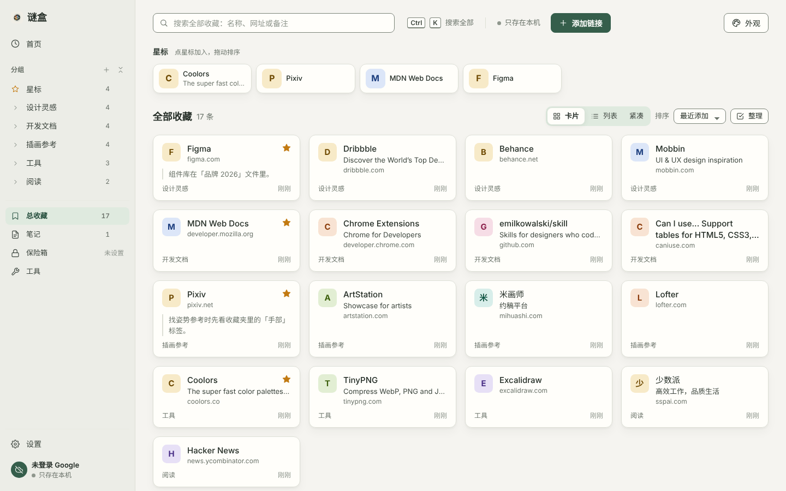
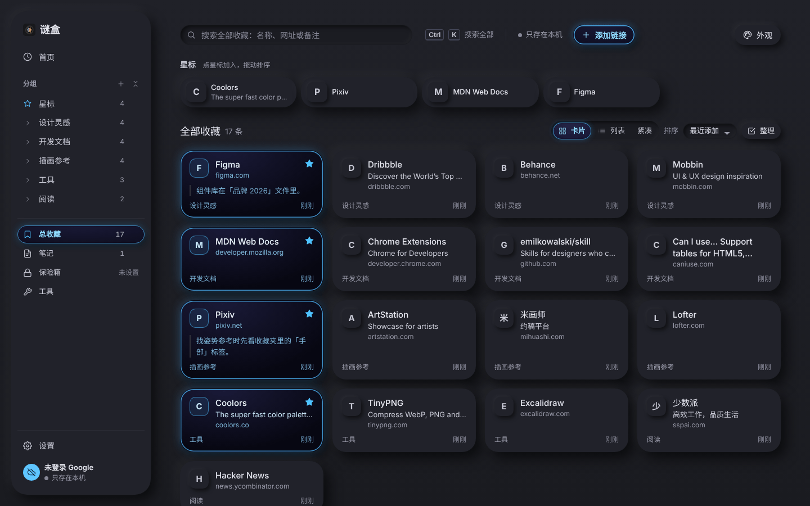
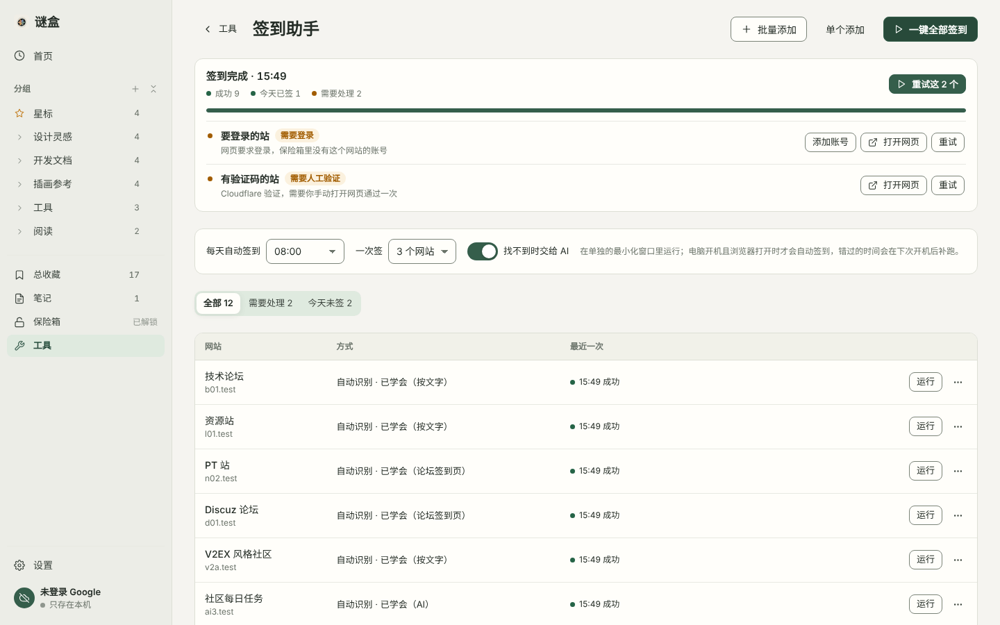

# 谜盒 Mibox

**你的私有书签系统。** 收藏、笔记、保险箱和签到助手放在一个 Chrome 插件里，资料只存在你的电脑和你自己的 Google Drive 应用私有空间，没有服务器、没有统计。



## 能做什么

- **收藏**：工具栏一点（或 `Alt+Shift+S`）就存下当前网页，马上可以改名、换分组、设星标、写备注。卡片 / 列表 / 紧凑三种显示，拖到分组、整理模式批量移动和删除，查找重复。可以从 Chrome 书签或任何浏览器的书签文件导入，也可以自动收录你在 Chrome 里点的星标。
- **首页**：授权后，按近期真实访问给你**已收藏**的网站排行（只在本机计算，不上传）；不授权就显示星标和最近打开。
- **快速搜索**：在任何网页按 `Alt+Shift+K`，同时搜收藏、笔记和保险箱。
- **笔记**：Markdown；侧栏（`Alt+Shift+B`）里边看网页边记，自动带上来源；网页上选中文字右键就能存成笔记。
- **保险箱**：网站登录、API 密钥、私密笔记，AES-256-GCM 加密；一键填入账号（网址对得上才填）；复制后 30 秒清空剪贴板；忘记主密码用恢复密钥。
- **签到助手**：批量添加要签到的网站，一键全部签到或每天定时。自动找签到按钮、判断成功，认得常见论坛，找不到时交给你自己的 AI 接口；成功一次就记住做法。不绕过验证码。→ [详细说明](docs/checkin.md)
- **网页发布**：把 HTML 文件或网站文件夹发布到 GitHub Pages / Cloudflare Pages。→ [详细说明](docs/publish.md)
- **同步**：登录 Google 后，同步到你 Drive 的应用私有空间。多台电脑各自上传快照、按条目合并，同一条笔记两边都改了会另存副本，不会丢。
- **外观**：9 套材质，浅色 / 深色 / 跟随系统，尊重系统的「减少动态效果」和「降低透明度」。

<p>
  
  
</p>

## 安装

需要 Google Chrome 123 或更新版本。

1. 到 [Releases](../../releases) 下载 `mibox-<版本号>.zip` 并解压；或者 `git clone` 这个仓库。
2. 打开 `chrome://extensions`，右上角打开「开发者模式」。
3. 点「加载已解压的扩展程序」，选解压出来的文件夹（如果是克隆的仓库，选里面的 **`extension`** 文件夹）。
4. 会打开「首次使用」页：用 Chrome 里的 Google 账号登录，或者先只在这台电脑上用；然后可以设置保险箱。
5. 点浏览器右上角的拼图图标，把「谜盒」固定到工具栏。

插件 ID 由 `manifest.json` 里的 `key` 固定为 `mdhhcfefflbkpbhgkflolailnmagdbbb`，放在哪个文件夹都一样，升级时直接替换文件夹里的文件再点「重新加载」，资料不会丢。**不要点「移除」**，移除会删掉这台电脑上的资料。

### Google 同步

仓库里的 `oauth2.client_id` 属于作者的 Google 项目。如果登录时被拒绝（比如项目只对测试名单开放），用插件里的向导花 10 分钟换成你自己的项目：「设置 › 高级设置 › 自己的 Google 项目」。不登录也能用，资料只存在本机。→ [配置说明](docs/google-setup.md)

同步需要 Chrome 自带的 Google 登录；Edge、Brave 等浏览器可以正常使用，但只能存在本机。

## 怎么用

| 入口 | 做什么 |
| --- | --- |
| 工具栏图标 `Alt+Shift+S` | 收藏当前网页；网站在保险箱里有账号时可以一键填入 |
| 快速搜索 `Alt+Shift+K` | 任何网页上搜收藏、笔记、保险箱。↑↓ 选择，回车打开，Shift+回车在当前页打开，Tab 换范围 |
| 侧栏 `Alt+Shift+B` | 边看网页边记笔记，摘录选中的文字 |
| 右键菜单 | 收藏此网页 / 收藏此链接 / 把选中的文字存为笔记 / 快速搜索 / 打开侧栏 |
| 完整页 | 首页、收藏、笔记、保险箱、工具、设置。`Ctrl+K` 搜索全部，`/` 聚焦搜索框，`N` 新建笔记 |

快捷键可以在 `chrome://extensions/shortcuts` 修改。

**导入与导出**（设置 › 收藏与导入）：从 Chrome 导入、导入任何浏览器的书签文件（.html）、导入备份；导出书签文件（任何浏览器都能导入）或完整备份（.json，收藏、分组、笔记、签到任务，可选带上加密的保险箱）。导入按网址合并，可以放心重复导入。

## 隐私与安全

- **不申请访问所有网站。** 签到、填入账号、摘录文字这类功能，第一次用到某个网站时才单独询问，随时可以在扩展详情页撤销。浏览历史也是可选权限。
- **网络请求只有这几处**：Google 账号与 Drive API（登录后同步）；你自己设置的 AI 接口（签到找不到入口、而且开着「找不到时交给 AI」时，只发可点元素的文字）；你在网页发布里连接的 GitHub / Cloudflare API。没有统计、没有中间服务器。
- **保险箱**：主密码至少 12 个字符，经 PBKDF2-SHA256（60 万次）派生密钥，包裹随机主密钥；每条记录用 AES-256-GCM 加密，附加数据绑定记录 ID。上传到云端的只有密文（条目名称和网站是明文，为了锁着也能搜到）。解锁后的密钥只在浏览器内存里，按设置自动锁定。
- **网页上的东西读不到插件**：快速搜索浮层是插件自己的页面（iframe + 关闭的 Shadow DOM），网页嵌入的伪造浮层没有一次性令牌，后台会拒绝。
- 笔记预览先整体转义再加标签，链接只认 `http(s)`。

发现安全问题请通过 GitHub 的 Security Advisory 私下报告，不要直接开公开 Issue。

## 开发

没有构建步骤：`extension/` 里就是插件本身，原生 ES 模块，改完在 `chrome://extensions` 点「重新加载」。

```
extension/
  manifest.json          插件清单
  background.js          后台入口（Manifest V3 service worker）
  offscreen.html/js      清空剪贴板用的离屏页
  src/shared/            后台和界面共用：网址与标题处理、默认设置、消息调用
  src/bg/                后台
    db.js workspace.js   本机数据库（IndexedDB）、每个账号一个独立资料库
    library.js           收藏、分组、笔记
    vault.js crypto.js   保险箱与加密
    google.js drive.js   Google 登录与 Drive 读写
    sync.js merge.js     同步与合并规则（merge.js 是纯函数）
    checkin*.js pageops.js  签到助手、技能包、页面点选
    publish*.js          网页发布
    frecency.js          首页排行
    actions.js router.js 右键菜单、快捷键、消息路由与权限检查
  src/content/           注入网页的脚本：快速搜索浮层、元素点选、令牌连接助手
  src/ui/kit/            界面基础：模板与局部更新（dom.js）、图标、样式、对话框
  src/ui/app/            完整页
  src/ui/popup/ sidepanel/ search/   工具栏弹窗、侧栏、快速搜索
tests/                   单元测试、端到端测试（Playwright）
scripts/                 检查与打包
docs/                    说明文档
```

```sh
sh scripts/check.sh            # 语法检查 + 单元测试（只需要 Node 22）
cd tests && npm install && npx playwright install chromium
npm run e2e:smoke              # 全新安装后打开所有页面，确认没有报错
npm run e2e:checkin            # 签到助手：50 个模拟网站跑三轮（约 4 分钟）
sh scripts/pack.sh             # 打包 dist/mibox-<版本号>.zip
```

排查问题：在 `chrome://extensions` 的「谜盒」上点「Service Worker」打开开发者工具看后台日志。

版本记录见 [CHANGELOG.md](CHANGELOG.md)。

## 许可证

[MIT](LICENSE) © 2026 谜盒作者

界面图标参照 [Feather Icons](https://github.com/feathericons/feather)（MIT）；BLAKE3 实现取自 [@noble/hashes](https://github.com/paulmillr/noble-hashes)（MIT）。见 [THIRD-PARTY-NOTICES.txt](extension/THIRD-PARTY-NOTICES.txt)。
